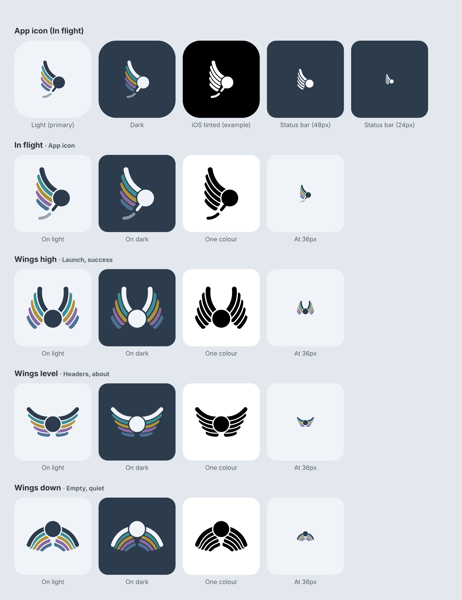

# Gaca mark



The Gaca mark is a small figure with crew-coloured wings. The wings nod to Hermes, the agent Gaca talks
to. The figure in flight says what Gaca is for: it takes the things you'd otherwise have to do every
time off your hands, so you can take off and be less tied down.

Each wing is five curved feathers. The top feather is the body colour and grows out of the figure. The
four below it are crew colours (teal, gold, plum, blue, all from the server's crew palette), each
shorter than the last and curling at the tip. There is **no red or terracotta anywhere**: in the app
that colour means "urgent", and a launcher icon shouldn't look like it needs you.

This kit is for both apps, Android and iOS. Everything is plain filled paths: the gaps between feathers
are real cut-outs, not background-coloured strokes. That means every file works on any background and
converts cleanly to Android vector drawables or an Xcode asset catalog.

## The four poses

| Pose | File stem | Suggested use |
|---|---|---|
| **In flight** | `gaca-in-flight` | The app icon. Also good for share sheets and "sent" or "on it" moments. |
| **Wings high** | `gaca-wings-high` | Launch or splash, onboarding, success ("all done"). |
| **Wings level** | `gaca-wings-level` | Steady-state brand mark: login screen, about screen, headers. |
| **Wings down** | `gaca-wings-down` | Resting: empty states ("nothing needs you"), quiet hours, offline or paused. |

These are suggestions, not rules. The general idea: wings up means something is happening or just
happened, level is neutral, and down means nothing needs you right now.

## Colours

| Role | Hex | Notes |
|---|---|---|
| Body, on light | `#2D3C4C` | Slate (the app's `HeaderAccent`) |
| Body, on dark | `#F0F4F9` | Pale (the app's `PageBackground`) |
| Feather 1 | `#3F8E93` | Teal |
| Feather 2 | `#B0923F` | Gold |
| Feather 3 | `#8A6A9E` | Plum |
| Feather 4 | `#4E7093` | Blue |
| Cut string (In flight only) | `#9AA6B2` on light, `#8796A6` on dark | A faded body colour, so the string reads as falling away |
| App icon background | `#F0F4F9` (light) / `#2D3C4C` (dark) | |

The feathers keep the same colours on light and dark backgrounds; only the body colour flips.

## What's in here

```
svg/
  gaca-<pose>-on-light.svg      slate body, for light surfaces (transparent background, tightly cropped)
  gaca-<pose>-on-dark.svg       pale body, for dark surfaces
  gaca-<pose>-mono.svg          one colour (black), for tinting, templates and single-colour use
  app-icon-light.svg            108x108 icon canvas, mark inside Android's adaptive-icon safe zone
  app-icon-dark.svg             same, dark
  app-icon-ios-light.svg        larger mark for iOS (iOS shows the whole square; Android crops it)
png/
  marks/gaca-<pose>-{on-light,on-dark,mono}-512.png   transparent, 512px on the long side
  app-icon/ios-app-icon-{light,dark,tinted}-1024.png  iOS 18 app icon appearances, opaque
  app-icon/play-store-icon-512.png                    Google Play listing icon
  app-icon/notification-silhouette-96.png             preview of the status-bar icon
android/res/                    drop-in Android resources (see below)
source/                         the generator: change the mark here, not in the exports
```

## Android

`android/res/` mirrors the app's `res/` folder:

- `mipmap-anydpi-v26/ic_launcher.xml` and `ic_launcher_round.xml`: adaptive icon with background,
  foreground **and** a `monochrome` layer, so Android 13+ themed icons work.
- `drawable/ic_launcher_foreground.xml`: In flight, colour, inside the 66dp safe zone.
- `drawable/ic_launcher_monochrome.xml`: the same shape in one colour, for themed icons.
- `values/ic_launcher_colors.xml`: `ic_launcher_background` = `#F0F4F9`. The app currently defines
  `ic_launcher_background` as slate in `values/colors.xml`, so change that value rather than adding a
  duplicate.
- `drawable/ic_notification.xml`: a status-bar silhouette. It's In flight simplified (no string, wider
  gaps between feathers) so it survives at 24dp. It replaces the current bell.
- `drawable/ic_gaca_<pose>.xml` + `drawable-night/ic_gaca_<pose>.xml`: the four poses for in-app use,
  48dp by default. The night versions have the pale body, so they switch automatically in dark theme.

## iOS

- App icon: `png/app-icon/ios-app-icon-light-1024.png` is the default (any appearance). For iOS 18 dark
  and tinted appearances, use `ios-app-icon-dark-1024.png` and `ios-app-icon-tinted-1024.png` (a
  greyscale mark on black, which the system tints).
- In-app marks: add the SVGs to the asset catalog with **Preserve Vector Data** checked. Use the
  `on-light` / `on-dark` pair as the Any / Dark appearances of one image set, or use the `mono` SVG as a
  template image and tint it.

## Changing the mark

Edit `source/mark.py` (geometry, colours, poses), then regenerate:

```
pip install skia-python
python3 source/export.py branding        # run from the repo root; rewrites svg/, png/, android/
node source/overview.js branding branding/overview.png   # optional; needs Playwright
```
